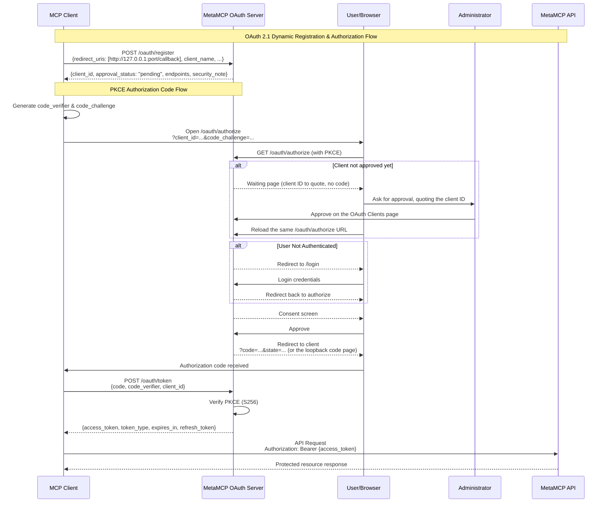

## OAuth

### Client registration and approval (Umbrella fork)

There are two ways a client comes to exist, and they follow different rules.

**Administrator-created clients.** An administrator creates a client on the OAuth
Clients page (the "Use Claude callbacks" preset fills in the claude.ai and claude.com
callbacks). It is approved from the start. This is how hosted applications, such as a
claude.ai or Claude Desktop organization connector, get a client. Their callbacks must
pass the shared redirect validator, whose non-loopback hosts are set by
`DCR_REDIRECT_URI_ALLOWED_HOSTS` (default `claude.ai, claude.com, anthropic.com`); the
same validator runs again on every authorize request.

**Self-registered clients** (`POST /oauth/register`, RFC 7591, anonymous):

- Accept only plain-http loopback callbacks: `http://localhost`, `http://127.0.0.1` or
  `http://[::1]`, on any port except the gateway's internal 12009. Anything else,
  including `https://localhost`, any hosted callback and a list with one such entry, is
  refused with `400 {"error": "invalid_redirect_uri"}` and nothing is stored. This is a
  rule of the registration endpoint only; it does not change the shared validator above.
- Are stored with `approval_status: "pending"`. The registration body cannot choose its
  status or approver.
- Cannot be authorized until approved. `GET /oauth/authorize` for a pending client shows a
  waiting page (no consent request, cookie or redirect) that tells the person to send the
  client ID to an administrator and reload the same page after approval; the client's
  `state`, callback and PKCE challenge are unchanged by the reload. A rejected client gets a
  page saying it was rejected.
- Consent info, the consent decision and both token grants (authorization code and refresh)
  also check the stored client and answer `unauthorized_client` unless its status is exactly
  `approved`.

Administrators approve or reject pending self-registered clients on the OAuth Clients page,
which shows each client's status, how it was created, and the network address its
registration came from (an observed address, not an identity). Approving lets people sign in
through the client; it grants nothing by itself, and each person still approves their own
access on the consent screen. These decisions are available only to an administrator's own
browser session, never to an admin-plane (CI) key. Each decision is audited
(`oauthclient.approve`, `oauthclient.reject`); refused registrations are audited as
`oauth.dcr.register` with outcome `denied`, and blocked authorize attempts as
`oauth.authorize.client_not_approved`.

`OAUTH_DCR_MODE` controls the registration endpoint (see `example.env`):

| Value             | Effect                                                                                                                                                                                                                                                                                                                                                                                                                                                                                                                                                                     |
| ----------------- | -------------------------------------------------------------------------------------------------------------------------------------------------------------------------------------------------------------------------------------------------------------------------------------------------------------------------------------------------------------------------------------------------------------------------------------------------------------------------------------------------------------------------------------------------------------------------- |
| `pending` (unset) | Loopback registrations are stored pending and wait for an administrator.                                                                                                                                                                                                                                                                                                                                                                                                                                                                                                   |
| `off`             | Registration answers `400 {"error": "registration_disabled", "error_description": "This gateway does not accept automatic client registration. Ask an administrator for a client."}`. `registration_endpoint` is left out of the authorization server metadata (cached for up to an hour, so clients may hold the old document that long), `GET /oauth/register` says registration is off, and an unknown client at `/oauth/authorize` is told to ask an administrator. Existing clients, approvals and grants are unchanged, and administrators can still create clients. |
| `open`            | Loopback registrations are approved automatically. Development and test only: the backend refuses to start with it unless `NODE_ENV` is `development` or `test`.                                                                                                                                                                                                                                                                                                                                                                                                           |

Any other value, including an empty one, behaves as `off` and logs a warning at startup.
`registration_disabled` is this gateway's own error code, not an RFC 7591 one.

Self-registered clients still pending after `DCR_CLIENT_RETENTION_DAYS` (default 7) are
deleted by the 5-minute cleanup, and rejected ones a day after rejection. Approved,
administrator-created and older clients are never deleted by that sweep.

What this does not cover: approval applies to a client record, not to each use of it. A
public client has no credential of its own and its ID appears in authorization URLs, so
approval does not establish which program is using an approved client. Each person's consent
still decides every grant, and the consent screen and the code page say who supplied the
application details and that the organization never asks anyone for a code.
