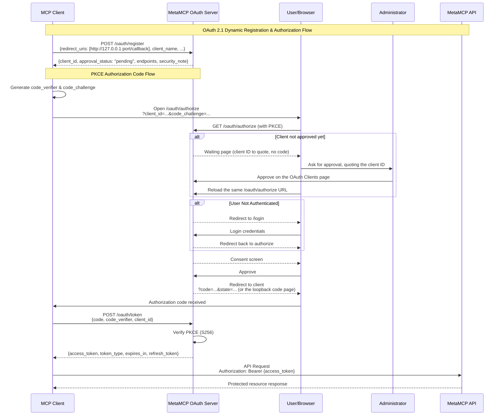

## OAuth

### Client registration and approval (Umbrella fork)

There are two ways a client comes to exist, and they follow different rules.

**Administrator-created clients.** An administrator creates a client on the OAuth
Clients page (the "Use Claude callbacks" preset fills in the claude.ai and claude.com
callbacks). It is approved from the start. This is how hosted applications, such as a
claude.ai or Claude Desktop organization connector, get a client. Their callbacks must
pass the shared redirect validator, whose non-loopback hosts are set by
`DCR_REDIRECT_URI_ALLOWED_HOSTS` (default `claude.ai, claude.com, anthropic.com`); the
same validator runs again on every authorize request.

**Self-registered clients** (`POST /oauth/register`, RFC 7591, anonymous):

- Accept only plain-http loopback callbacks: `http://localhost`, `http://127.0.0.1` or
  `http://[::1]`, on any port except the gateway's internal 12009. Anything else,
  including `https://localhost`, any hosted callback and a list with one such entry, is
  refused with `400 {"error": "invalid_redirect_uri"}` and nothing is stored. This is a
  rule of the registration endpoint only; it does not change the shared validator above.
- Are stored with `approval_status: "pending"`. The registration body cannot choose its
  status or approver.
- Cannot be authorized until approved. `GET /oauth/authorize` for a pending client shows a
  waiting page (no consent request, cookie or redirect) that tells the person to send the
  client ID to an administrator and reload the same page after approval; the client's
  `state`, callback and PKCE challenge are unchanged by the reload. A rejected client gets a
  page saying it was rejected.
- Consent info, the consent decision and both token grants (authorization code and refresh)
  also check the stored client and answer `unauthorized_client` unless its status is exactly
  `approved`.

Administrators approve or reject pending self-registered clients on the OAuth Clients page,
which shows each client's status, how it was created, and the network address its
registration came from (an observed address, not an identity). Approving lets people sign in
through the client; it grants nothing by itself, and each person still approves their own
access on the consent screen. These decisions are available only to an administrator's own
browser session, never to an admin-plane (CI) key. Each decision is audited
(`oauthclient.approve`, `oauthclient.reject`); refused registrations are audited as
`oauth.dcr.register` with outcome `denied`, and blocked authorize attempts as
`oauth.authorize.client_not_approved`.

`OAUTH_DCR_MODE` controls the registration endpoint (see `example.env`):

| Value             | Effect                                                                                                                                                                                                                                                                                                                                                                                                                                                                                                                                                                     |
| ----------------- | -------------------------------------------------------------------------------------------------------------------------------------------------------------------------------------------------------------------------------------------------------------------------------------------------------------------------------------------------------------------------------------------------------------------------------------------------------------------------------------------------------------------------------------------------------------------------- |
| `pending` (unset) | Loopback registrations are stored pending and wait for an administrator.                                                                                                                                                                                                                                                                                                                                                                                                                                                                                                   |
| `off`             | Registration answers `400 {"error": "registration_disabled", "error_description": "This gateway does not accept automatic client registration. Ask an administrator for a client."}`. `registration_endpoint` is left out of the authorization server metadata (cached for up to an hour, so clients may hold the old document that long), `GET /oauth/register` says registration is off, and an unknown client at `/oauth/authorize` is told to ask an administrator. Existing clients, approvals and grants are unchanged, and administrators can still create clients. |
| `open`            | Loopback registrations are approved automatically. Development and test only: the backend refuses to start with it unless `NODE_ENV` is `development` or `test`.                                                                                                                                                                                                                                                                                                                                                                                                           |

Any other value, including an empty one, behaves as `off` and logs a warning at startup.
`registration_disabled` is this gateway's own error code, not an RFC 7591 one.

Self-registered clients still pending after `DCR_CLIENT_RETENTION_DAYS` (default 7) are
deleted by the 5-minute cleanup, and rejected ones a day after rejection. Approved,
administrator-created and older clients are never deleted by that sweep.

What this does not cover: approval applies to a client record, not to each use of it. A
public client has no credential of its own and its ID appears in authorization URLs, so
approval does not establish which program is using an approved client. Each person's consent
still decides every grant, and the consent screen and the code page say who supplied the
application details and that the organization never asks anyone for a code.

### Authorization-code replay (Umbrella fork)

RFC 6749 section 4.1.2 says an authorization code used more than once must be denied and
the tokens issued from it should be revoked. Redeeming a code deletes it, so a second
redemption was always denied with `invalid_grant`, but nothing recorded which tokens the
code had produced and nothing was logged, so whoever redeemed it first stayed signed in.

Every redeemed code now leaves a record for about 15 minutes (the code's lifetime plus five
minutes): the token family it started, the client, the redirect URI and the PKCE challenge,
keyed on the same hash the live code uses and never on the code. It is written in the same
database transaction as the token pair, so the two exist together or not at all. A failed
write fails the grant and the code stays redeemable.

A later presentation of that code is acted on only when it proves possession of the
original exchange: the same client and redirect URI, a `code_verifier` whose S256 digest is
the stored challenge, and for a confidential client its secret. Anything less changes
nothing and writes nothing. Codes travel in redirect URLs, so a code alone is something an
observer can hold; without this check, detection would be a way to end someone else's
session. This narrows the RFC's "should revoke" on purpose.

A presentation that passes writes one `oauth.token.reuse` audit row (`detail.reason` is
`authorization_code_reuse`, as distinct from `refresh_token_reuse`) and uses up the record,
so one compromised code produces one row however often it is replayed. The row says how
many tokens of the family were live (`tokens_live`) and whether this request revoked them
(`family_revoked`). The caller always gets the same `invalid_grant` it got before, in every
mode.

`OAUTH_CODE_REPLAY` chooses what happens next (see `example.env`):

| Value         | Effect                                                                                                                               |
| ------------- | ------------------------------------------------------------------------------------------------------------------------------------ |
| `log` (unset) | Audit only. `tokens_live` above zero is a replay that `revoke` would have turned into a sign-out. Nothing is revoked.                |
| `revoke`      | The same validated replay also revokes the whole token family (the refresh-token family revoke), so the first caller's session ends. |
| `off`         | No record is written, read or removed and no row is written. The full rollback.                                                      |

Any other value behaves as `log` and logs a warning naming it. The value in effect is logged
once at startup.

Moving from `log` to `revoke` is a deliberate step. Whether a real client ever submits the
same code twice after receiving its tokens is not known, and under `revoke` that client
would lose its session. Run `log` for at least a week and read the `authorization_code_reuse`
rows first; the flip is safe when none has `tokens_live` above zero from a client you know.
After the flip, a replay row with `family_revoked: true` followed within minutes by a new
grant for the same user and client means a legitimate client double-submits: set `log` and
investigate.

After deploying migration 0045, confirm it took effect before relying on any of this:
`SELECT to_regclass('oauth_spent_authorization_codes')` returns the table name. If it is
null, logins fail loudly (the record write is part of the grant); set `OAUTH_CODE_REPLAY=off`
to restore them while the migration is investigated.
