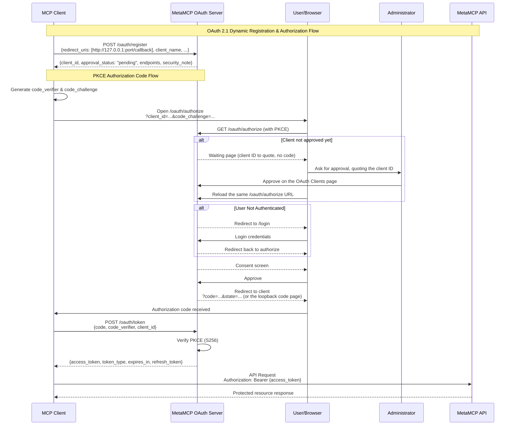

## OAuth

### Client registration and approval (Umbrella fork)

There are two ways a client comes to exist, and they follow different rules.

**Administrator-created clients.** An administrator creates a client on the OAuth
Clients page (the "Use Claude callbacks" preset fills in the claude.ai and claude.com
callbacks). It is approved from the start. This is how hosted applications, such as a
claude.ai or Claude Desktop organization connector, get a client. Their callbacks must
pass the shared redirect validator, whose non-loopback hosts are set by
`DCR_REDIRECT_URI_ALLOWED_HOSTS` (default `claude.ai, claude.com, anthropic.com`); the
same validator runs again on every authorize request.

**Self-registered clients** (`POST /oauth/register`, RFC 7591, anonymous):

- Accept only plain-http loopback callbacks: `http://localhost`, `http://127.0.0.1` or
  `http://[::1]`, on any port except the gateway's internal 12009. Anything else,
  including `https://localhost`, any hosted callback and a list with one such entry, is
  refused with `400 {"error": "invalid_redirect_uri"}` and nothing is stored. This is a
  rule of the registration endpoint only; it does not change the shared validator above.
- Are stored with `approval_status: "pending"`. The registration body cannot choose its
  status or approver.
- Cannot be authorized until approved. `GET /oauth/authorize` for a pending client shows a
  waiting page (no consent request, cookie or redirect) that tells the person to send the
  client ID to an administrator and reload the same page after approval; the client's
  `state`, callback and PKCE challenge are unchanged by the reload. A rejected client gets a
  page saying it was rejected.
- Consent info, the consent decision and both token grants (authorization code and refresh)
  also check the stored client and answer `unauthorized_client` unless its status is exactly
  `approved`.

Administrators approve or reject pending self-registered clients on the OAuth Clients page,
which shows each client's status, how it was created, and the network address its
registration came from (an observed address, not an identity). Approving lets people sign in
through the client; it grants nothing by itself, and each person still approves their own
access on the consent screen. These decisions are available only to an administrator's own
browser session, never to an admin-plane (CI) key. Each decision is audited
(`oauthclient.approve`, `oauthclient.reject`); refused registrations are audited as
`oauth.dcr.register` with outcome `denied`, and blocked authorize attempts as
`oauth.authorize.client_not_approved`.

`OAUTH_DCR_MODE` controls the registration endpoint (see `example.env`):

| Value             | Effect                                                                                                                                                                                                                                                                                                                                                                                                                                                                                                                                                                     |
| ----------------- | -------------------------------------------------------------------------------------------------------------------------------------------------------------------------------------------------------------------------------------------------------------------------------------------------------------------------------------------------------------------------------------------------------------------------------------------------------------------------------------------------------------------------------------------------------------------------- |
| `pending` (unset) | Loopback registrations are stored pending and wait for an administrator.                                                                                                                                                                                                                                                                                                                                                                                                                                                                                                   |
| `off`             | Registration answers `400 {"error": "registration_disabled", "error_description": "This gateway does not accept automatic client registration. Ask an administrator for a client."}`. `registration_endpoint` is left out of the authorization server metadata (cached for up to an hour, so clients may hold the old document that long), `GET /oauth/register` says registration is off, and an unknown client at `/oauth/authorize` is told to ask an administrator. Existing clients, approvals and grants are unchanged, and administrators can still create clients. |
| `open`            | Loopback registrations are approved automatically. Development and test only: the backend refuses to start with it unless `NODE_ENV` is `development` or `test`.                                                                                                                                                                                                                                                                                                                                                                                                           |

Any other value, including an empty one, behaves as `off` and logs a warning at startup.
`registration_disabled` is this gateway's own error code, not an RFC 7591 one.

Self-registered clients still pending after `DCR_CLIENT_RETENTION_DAYS` (default 7) are
deleted by the 5-minute cleanup, and rejected ones a day after rejection. Approved,
administrator-created and older clients are never deleted by that sweep.

What this does not cover: approval applies to a client record, not to each use of it. A
public client has no credential of its own and its ID appears in authorization URLs, so
approval does not establish which program is using an approved client. Each person's consent
still decides every grant, and the consent screen and the code page say who supplied the
application details and that the organization never asks anyone for a code.

### Client ID Metadata Documents (Umbrella fork)

A client can use an `https` URL as its `client_id`; the JSON document published at that URL
is its registration ([OAuth Client ID Metadata Document](https://datatracker.ietf.org/doc/html/draft-ietf-oauth-client-id-metadata-document),
referenced by the MCP authorization spec). It ships **off**. `OAUTH_CIMD_ALLOWED_CLIENTS`
is empty, so nothing below applies, the authorization server metadata omits
`client_id_metadata_document_supported`, and an `https` client id is answered exactly as
before (unknown client, with the registration hint).

**What happens when it is on.** The list holds exact client metadata URLs and `https`
origins (`https://host`, optionally with a port). On `GET /oauth/authorize`, a client id that
is an https URL goes through these steps in order:

1. The id must be canonical (exactly as the URL parser prints it: lower-case host, no
   default port, no dot segments, no query, no fragment, no userinfo, a path other than
   `/`, a DNS name rather than an IP address, at most 512 characters).
2. The id must be on the list. **An unlisted URL is refused here, before any DNS lookup,
   connection or database write.** There is no approval queue for unlisted URLs.
3. A row stored in the last hour is used as it is. Otherwise the document is fetched
   through the gateway's guarded fetch: public addresses only (private, loopback,
   link-local and metadata ranges are refused, whatever `MCP_PROXY_URL_ALLOWED_HOSTS` says),
   the socket pinned to the checked addresses, no redirects followed, at most 5 KiB, at most
   10 seconds in total. At most 16 fetches run at once and 60 start a minute; one failed
   id is not fetched again for a minute; at most 500 client metadata rows exist.
4. The document is validated: its `client_id` must equal its URL exactly; it must be a public
   client (no `client_secret`, no shared-secret `token_endpoint_auth_method`); grant types
   limited to `authorization_code` and `refresh_token`; and **every `redirect_uris` entry must
   be a hosted `https` callback**. A document that lists a loopback address or a private-use
   scheme is refused, so a command-line client that listens on localhost keeps using dynamic
   registration. Hosted callbacks go through the same host rule as every other client
   (`DCR_REDIRECT_URI_ALLOWED_HOSTS`, default `claude.ai, claude.com, anthropic.com`): a
   callback host outside it needs that list widened, which also widens anonymous registration.
5. The result is stored as an approved client of source `cimd`. The allowlist entry is the
   approval; no administrator decision applies and the OAuth Clients page offers none.

Every authorize-time refusal of a URL client id answers with the same
`400 {"error": "invalid_client", "error_description": "The client could not be verified."}`,
whatever the reason (not listed, fetch failed, document invalid, address refused), so the
response is not an oracle for the list or for which addresses this host can reach. The reason is
in the audit log (`oauth.cimd.resolve`, one refusal row per client id and reason per hour and at
most 50 an hour; success rows only when a document is first stored or changes) and the gateway
log. The document body is never stored in the audit log.

**What the screens say.** The consent screen shows the host the document was published from
("Client details published by ..."), beside the unchanged name note, callback and warning. That
is a statement about where the details came from, not a verification of the client: the
warning still says to approve only if you started the connection. Document names are cleaned of
control and bidirectional characters. A `cimd` client appears on the OAuth Clients page as
"Client metadata document".

**Removing an entry.** The authorize, consent info, consent decision and token endpoints (both
grants) refuse a `cimd` row whose id is no longer listed, before any code is consumed or refresh
token claimed, so nothing is burnt and the same request works again if the entry returns. Access
tokens already issued live until they expire; to end them sooner delete the client (OAuth Clients
page), which revokes its tokens, after removing the entry (a deleted client is recreated by the
next authorize while the entry exists). The authorization server metadata is served with a
one-hour `Cache-Control`, so a client or intermediary may keep the old flag for up to an hour;
a URL client id that is no longer listed is refused regardless. Rows of any other source are never
affected by the list, and `cimd` rows unused for 30 days with no token, code or rotated marker are
deleted by the 5-minute cleanup.

**Before turning it on.** Advertising the flag makes every CIMD-capable client that needs a
new registration use a URL client id, and the MCP SDK client does not fall back to registration
when that id is refused. A client that already holds stored client information keeps using it,
so an existing connection working is not evidence that a new one would. So:

1. Confirm the 0046 migration took effect (`oauth_clients_registration_source_valid` names
   `cimd`).
2. Probe each intended client's metadata URL from the gateway's own egress and read the
   response (some CDNs challenge automated requests): it must be HTTP 200 JSON with `client_id`
   equal to the URL, hosted callbacks only and no secret.
3. Census the clients in use. A client that registers with a loopback callback and sends a
   metadata URL is refused after the flag is on; it blocks activation.
4. Canary a fresh registration for every intended client class on a non-production instance
   first, and read the `oauth.cimd.resolve` rows (a `denied` row with `not_allowlisted` shows
   the URL a client actually sent).
5. Prefer exact URLs. Use an origin entry only where every path under that origin is controlled
   by the client's operator: an origin entry admits every canonical id under it, limited only by
   the callback host rule and the 500-row cap. Before listing a hosted product, record whether
   its current administrator-created client is confidential; a client that is already working
   can stay as it is.

To switch off: clear the variable and restart. To roll the image back below the version that
introduced this, clear it, delete the `cimd` clients (this revokes their tokens and forces
those connections to start again), and then roll back: an older image's OAuth Clients list
rejects the `cimd` value.

A backend named in `VERIFIED_CALLER_SERVER_NAMES` receives, for a URL client, the credential
`oauth:cimd.<first 32 hex of sha256(client id)>.<first 16 hex of the token family id>` in
`X-Umbrella-Caller`. The family half is per connection (constant across refreshes), so two
installs of one product are two credentials, as two registered clients would be; a backend
cannot recover the URL from it.
